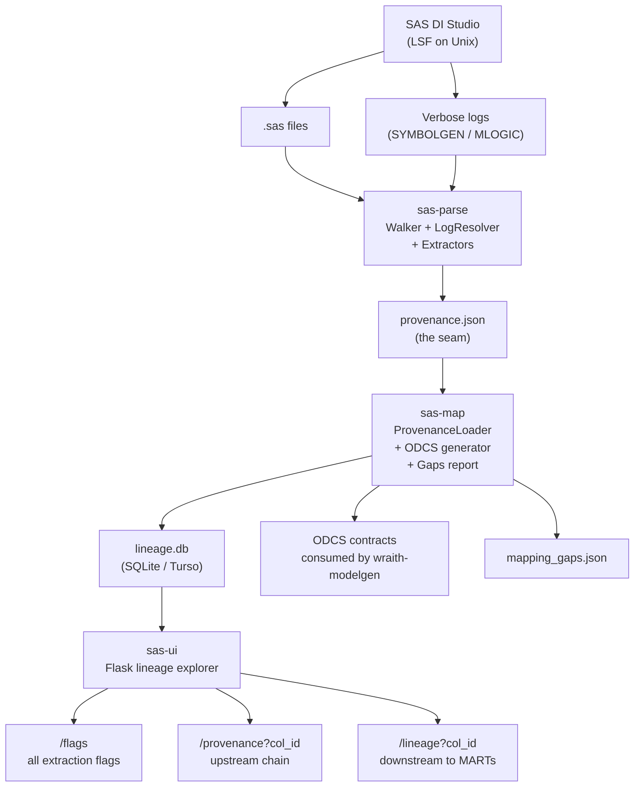
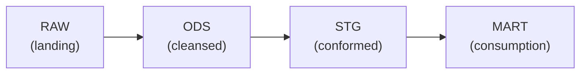
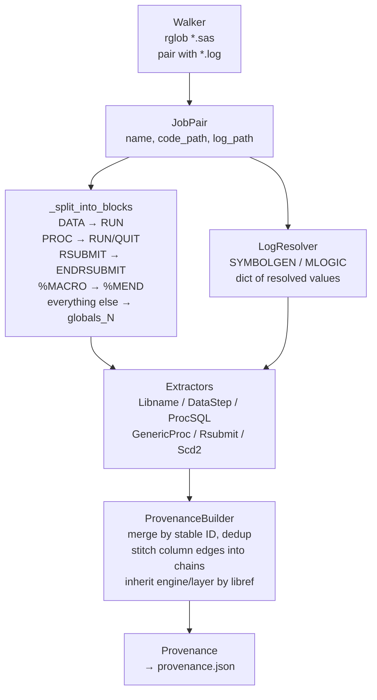
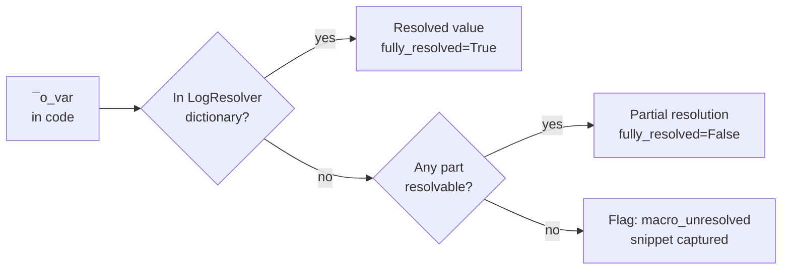
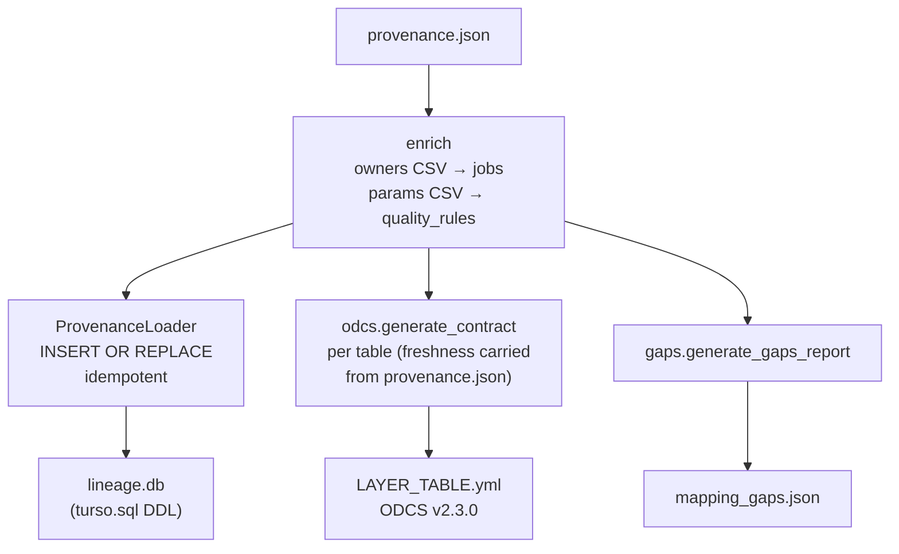
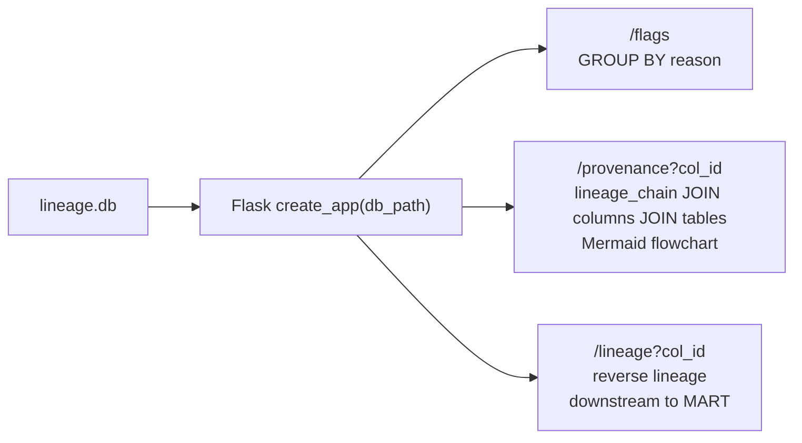

# 👻 Architecture

wraith-sas-lineage is a pipeline: SAS code in, ODCS contracts and a queryable lineage graph out. Three tools. One JSON seam.

---

## Pipeline overview

---

## Data layers

SAS estate layers map to canonical values throughout the schema:

Lineage chains track column flow from RAW through to MART. The `lineage_chain` table stores one row per source→mart column pair with chain order.

---

## Tool 1: Parser

### Step splitter

`_split_into_blocks(code)` scans a SAS source file and splits it into `(step_name, block)` pairs at block boundaries:

| Step type | Terminates at |
|---|---|
| `DATA` | `RUN;` |
| `PROC` | `RUN;` or `QUIT;` |
| `RSUBMIT` | `ENDRSUBMIT;` (inner `RUN;` is not a terminator) |
| `%MACRO` | `%MEND;` |
| Global (LIBNAME, %LET, OPTIONS) | collected into `globals_N` blocks |

Block comments (`/* ... */`) are stripped before scanning.

### Macro resolution

Log-first strategy:

### Stable IDs

All IDs are content-hashed: `<prefix>_<sha256[:12]>`. Inputs are uppercased before hashing. IDs are case-insensitive and stable across re-runs.

| Entity | Prefix | Hash input |
|---|---|---|
| Table | `tbl_` | `LIBREF.NAME` |
| Column | `col_` | `TABLE_ID.NAME` |
| Job | `job_` | `JOB_NAME` |
| Lineage chain | `lc_` | `MART_COL_ID.SOURCE_COL_ID.ORDER` |
| Quality rule | `qr_` | `JOB_ID.RULE_NAME` |

### Column-level lineage

Each DATA step and PROC SQL statement emits:

- **Columns:** one `Column` object per output column (derived from assignment, SELECT list, etc.)
- **LineageChain:** one chain hop per transformation, carrying:
  - `transformation_logic`: the verbatim SQL expression, CASE/WHEN, or assignment text (auditable at source)
  - `step_type`: the SAS step that performed the transformation
  - `chain_order`: position in the full source→MART chain (0 = direct source)
  - `data_type_at_step`: nullable, inferred from PROC CONTENTS logs
  - `unmappable_reason`: populated if the chain hop could not be fully resolved

The builder stitches per-step edges into full source→MART chains, so a single flat query on `lineage_chain` ordered by `chain_order` answers the complete provenance of any MART column. Unresolvable items are flagged rather than dropped, so lineage graphs are queryable even when incomplete.

---

## Tool 2: Schema Mapper

---

## Tool 3: Web UI

Local Flask app. SQLite connection per request via `g.db`. No write endpoints.

---

## Module map

| Module | Responsibility |
|---|---|
| `models.py` | All dataclasses and enums. Single source of truth for the domain. |
| `ids.py` | Content-hashed stable ID generators. |
| `parser/patterns.py` | SAS regex library. |
| `parser/walker.py` | Filesystem traversal; pairs `.sas` with `.log`. |
| `parser/log_resolver.py` | Parses SYMBOLGEN/MLOGIC lines; resolves `&macro_var`; collects run timestamps. |
| `parser/freshness.py` | Infers run frequency from job-name tokens or log run timestamps. |
| `parser/builder.py` | Orchestrates walker, splitter, extractors; stitches column edges into chains; inherits engine/layer by libref. |
| `parser/extractor.py` | `StepExtractor` Protocol: the extractor interface. |
| `parser/extractors/` | One extractor per SAS step type. |
| `parser/reconciler.py` | Excel mapping reconciliation (openpyxl). |
| `schema_mapper/loader.py` | Loads provenance into SQLite. Applies `schema/turso.sql` DDL. |
| `schema_mapper/odcs.py` | Generates ODCS v2.3.0 YAML per table. |
| `schema_mapper/enrich.py` | Merges manual owner/domain and quality-rule CSVs (keyed by job name). |
| `schema_mapper/gaps.py` | Generates `mapping_gaps.json`. |
| `web_ui/app.py` | Flask factory. |
| `web_ui/views/` | Three route handlers: flags, provenance, lineage. |

---

## Design decisions

**Flag-never-drop.** Unresolvable items become `Flag` objects. They propagate into ODCS under `lineageFlags` and are queryable from the UI. Silent discard would mean incorrect lineage graphs.

**Log-first macro resolution.** SAS DI Studio generates `&input_N_col_name` / `&output_N_col_name` macro variables for column aliases. These cannot be resolved from code alone. SYMBOLGEN logs are the authoritative source.

**All extractors run per block.** There is no `break` after first match. A RSUBMIT block containing a LIBNAME statement triggers both `LibnameExtractor` and `RsubmitExtractor`. Extractors are designed to be additive.

**Single JSON seam.** `provenance.json` is the only interface between Tool 1 and Tools 2/3. Each tool is independently invocable, testable, and replaceable.

**Stdlib tokeniser for PROC SQL.** A flat regex cannot see paren depth, string literals, or distinguish FROM commas from select-list commas. The `sql_tokeniser.py` module performs a single left-to-right scan that tracks parenthesis depth and skips quoted strings (including SAS doubled-quote escapes `''` and `""`), then walks the token stream to harvest all FROM/JOIN tables including those in subqueries and comma-joins. This replaced an earlier regex that mis-split multi-table sources.
