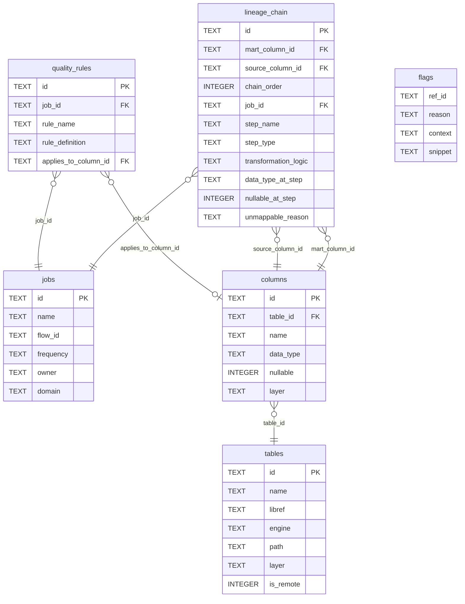

# 👻 Technical Reference

## provenance.json schema

Full JSON Schema at `schema/provenance.schema.json` (draft/2020-12).

### Top-level structure

```json
{
  "meta": { ... },
  "tables": [ ... ],
  "columns": [ ... ],
  "jobs": [ ... ],
  "lineage_chain": [ ... ],
  "quality_rules": [ ... ],
  "flags": [ ... ],
  "reconciliation": { ... }
}
```

### `meta`

| Field | Type | Description |
|---|---|---|
| `generated_at` | ISO 8601 string | UTC timestamp of the parse run |
| `parser_version` | string | `wraith-sas-lineage` version |
| `estate` | string | Estate identifier (e.g. `acme-risk`) |
| `job_count` | integer | Number of jobs parsed |
| `flow_count` | integer | Number of distinct flow IDs found |

### `tables[]`

| Field | Type | Description |
|---|---|---|
| `id` | `tbl_<12hex>` | Content-hashed stable ID |
| `name` | string | Dataset name (uppercased) |
| `libref` | string | SAS library reference |
| `engine` | string | `BASE`, `DB2`, `ORACLE`, etc. |
| `path` | string | Filesystem path (if LIBNAME BASE) |
| `layer` | enum | `RAW`, `ODS`, `STG`, `MART` |
| `is_remote` | bool | `true` for SLIBREF / RSUBMIT tables |

### `columns[]`

| Field | Type | Description |
|---|---|---|
| `id` | `col_<12hex>` | Content-hashed stable ID |
| `table_id` | `tbl_<12hex>` | Parent table |
| `name` | string | Column name (uppercased) |
| `data_type` | string | `NUM`, `CHAR`, or BigQuery type |
| `nullable` | bool | |
| `layer` | enum | Inherited from parent table |

### `jobs[]`

| Field | Type | Description |
|---|---|---|
| `id` | `job_<12hex>` | Content-hashed stable ID |
| `name` | string | Job name (SAS file stem) |
| `flow_id` | string or null | Flow scheduler flow ID |
| `frequency` | enum or null | `daily`, `weekly`, `monthly`, `quarterly`, `annual` |
| `frequency_evidence` | string[] | Evidence tokens (e.g. `name_token:daily`) |
| `owner` | string or null | Job owner (to be populated post-parse) |
| `domain` | string or null | Business domain |

### `lineage_chain[]`

| Field | Type | Description |
|---|---|---|
| `id` | `lc_<12hex>` | Content-hashed stable ID |
| `mart_column_id` | `col_<12hex>` | Terminal MART/MART column |
| `source_column_id` | `col_<12hex>` | Source column at this hop |
| `chain_order` | integer | Position in the chain (0 = direct source) |
| `job_id` | `job_<12hex>` | Job that performs this transformation |
| `step_name` | string | Step identifier within the job (e.g. `step_1`, `SQL_01`) |
| `step_type` | enum | `DATA`, `PROC_SQL`, `PROC_FORMAT`, `PROC_SORT`, `SCD2`, `RSUBMIT`, `OTHER` |
| `transformation_logic` | string | Verbatim transformation: CASE expression, assignment, SELECT-list item, etc. |
| `data_type_at_step` | string or null | Column data type as inferred at this step (from PROC CONTENTS logs) |
| `nullable_at_step` | boolean or null | Whether column is nullable at this step |
| `unmappable_reason` | enum or null | If non-null, reason the chain hop could not be fully resolved |

### `flags[]`

| Field | Type | Description |
|---|---|---|
| `ref_id` | string | ID of the referencing entity |
| `reason` | enum | `macro_unresolved`, `dynamic_column_name`, `hand_written_code`, `remote_execution`, `step_count_mismatch`, `multi_source` |
| `context` | string | Human-readable explanation |
| `snippet` | string | Relevant code or log excerpt |

**Flag reasons:**

- `macro_unresolved`: a `&macro_var` reference in code that could not be resolved via log SYMBOLGEN/MLOGIC or code-level `%LET`/`%SYSLPUT`
- `dynamic_column_name`: output column name is a macro reference (e.g. `&var`), so the name is unknown
- `hand_written_code`: DATA step with no SET/MERGE, implying bespoke logic with no clear upstream
- `remote_execution`: block executes on a remote server via RSUBMIT, so tracing is incomplete
- `step_count_mismatch`: log shows a different number of step completions than code contains blocks
- `multi_source`: (a) unqualified column in a multi-table join (source ambiguous), or (b) DATA step MERGEs >1 source (per-column upstream unresolved), or (c) PROC SQL statement with an unresolved macro source alongside real sources (attribution partial)

### `reconciliation`

Populated by `reconcile()` if an Excel mapping file is supplied.

| Field | Type | Description |
|---|---|---|
| `excel_supplied` | bool | Whether an Excel file was provided |
| `matches` | integer | Pairs present in both parser output and Excel |
| `mismatches` | string[] | Pairs whose source matches but target differs |
| `parser_only` | string[] | Pairs found by parser but not in Excel |
| `excel_only` | string[] | Pairs in Excel but not found by parser |

---

## Turso / SQLite schema

Full DDL at `schema/turso.sql`. Key design choices:

- `PRAGMA foreign_keys = ON`
- `PRAGMA journal_mode = WAL` (concurrent reads during writes)
- All tables use `CREATE TABLE IF NOT EXISTS`: re-runnable
- `INSERT OR REPLACE` in `loader.py`: idempotent multi-run

### Tables



### Key indexes

| Index | Columns | Purpose |
|---|---|---|
| `idx_lc_mart` | `lineage_chain(mart_column_id, chain_order)` | `/provenance` upstream chain lookup |
| `idx_lc_source` | `lineage_chain(source_column_id)` | `/lineage` downstream lookup |
| `idx_col_table` | `columns(table_id)` | Column listing per table |

---

## StepExtractor Protocol

```python
class StepExtractor(Protocol):
    def can_extract(self, code_block: str) -> bool: ...

    def extract(
        self,
        code_block: str,
        resolver: LogResolver,
        job_id: str,
        step_name: str,
    ) -> tuple[list[Table], list[Column], list[LineageChain], list[Flag]]:
        ...
```

All extractors that `can_extract()` a block run on it. There is no early exit. Return empty lists for categories the extractor does not produce; never raise.

---

## SAS regex patterns

All patterns in `parser/patterns.py`.

| Constant | Pattern | Matches |
|---|---|---|
| `LIBNAME_STMT` | `libname\s+(\w+)` | Any LIBNAME statement |
| `LIBNAME_PATH` | `libname\s+\w+[^;]+['"]([^'"]+)['"]` | Quoted filesystem path |
| `LIBNAME_SLIBREF` | `libname\s+(\w+)\s+slibref\s*=\s*(\w+)\s+server\s*=\s*(&?\w+)` | Remote library alias |
| `DATA_TARGET` | `\A\s*data\s+([A-Za-z]\w{0,7})\.(\w+)` | `data LIBREF.DSN` |
| `SET_STMT` | `\b(SET\|MERGE\|MODIFY\|UPDATE)\b\s+([A-Za-z]\w{0,7})\.(\w+)` | Source datasets |
| `SQL_CREATE_TABLE` | `\bcreate\s+table\s+(?:([A-Za-z]\w{0,7})\.)?(\w+)\s+as\b` | PROC SQL output |
| `SQL_FROM` | `\bfrom\b\s+(?:([A-Za-z]\w{0,7})\.)?(\w+)` | FROM clause source |
| `SQL_JOIN` | `\bjoin\b\s+(?:([A-Za-z]\w{0,7})\.)?(\w+)` | JOIN source |
| `SQL_CASE_EXPR` | `(CASE\s+WHEN\b[^;]+?END)\s+AS\s+(\w+)` | CASE/WHEN transformation |
| `RSUBMIT_START` | `\brsubmit\b` | RSUBMIT block start |
| `RSUBMIT_END` | `\bendrsubmit\b` | RSUBMIT block end |
| `SCD2_MACRO` | `%(?:\w+_)?scd2?\w*\b` | `%di_scd2_load`, `%scd2`, etc. |
| `LOG_SYMBOLGEN` | `SYMBOLGEN:\s+Macro variable (\w+) resolves to (.+)$` | Resolved macro value |
| `LOG_MLOGIC_VAR` | `MLOGIC\((\w+)\):\s+%LET\s+(\w+)\s*=\s*(.+)$` | %LET inside macro |
| `DI_AUTOGEN_COL` | `&(input_\d+_col_name\|output_\d+_col_name)\b` | DI Studio autogen column refs |

The `|soix` SAS PERL modifiers translate to Python `re.IGNORECASE | re.DOTALL` as appropriate.
