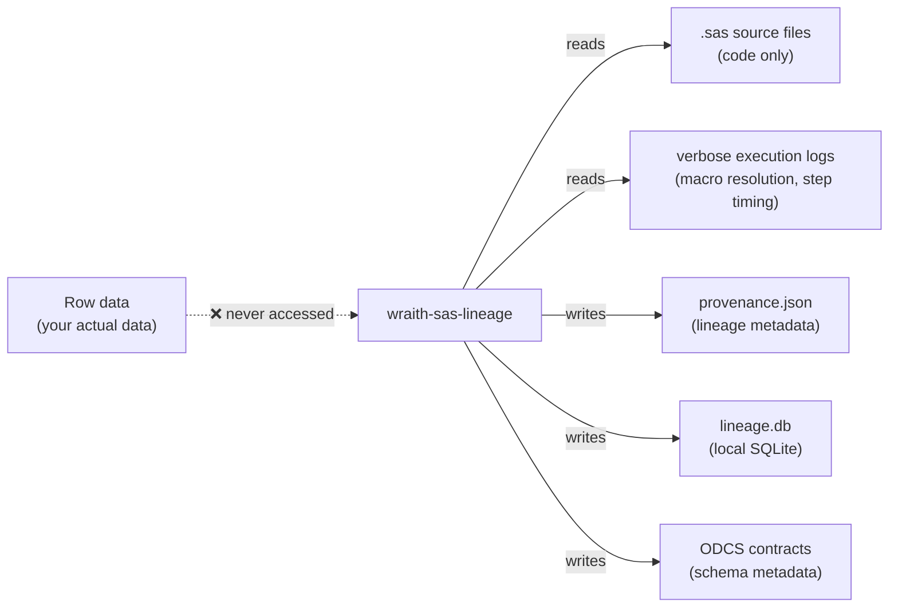

# 👻 Security Statement

wraith-sas-lineage reads source code and log files. It does not read row data.

---

## What it reads



The parser extracts structural information: table names, column names, transformation logic in CASE expressions, macro variable values from logs. It never opens a database connection to any SAS library.

---

## Credentials

wraith-sas-lineage requires no credentials. It operates entirely on local files: `.sas` source code, execution log files, and the local SQLite database.

No tokens, API keys, or service accounts are required or consumed.

---

## Sensitive content in logs

Verbose SAS logs (`SYMBOLGEN`/`MLOGIC` output) may contain runtime macro variable values, which can include dates, environment names, or configuration strings. The log resolver captures these only to resolve dataset name references; they are stored in `provenance.json` under `frequency_evidence` and `flag.context` fields.

Review `provenance.json` before committing it to version control. It should be treated as internal documentation, not a public artefact.

---

## Secrets in SAS code

The pre-commit configuration includes `detect-secrets` to block accidental credential commits. If it flags a false positive, update `.secrets.baseline` rather than disabling the hook:

```bash
detect-secrets scan > .secrets.baseline
```

---

## The web UI

`sas-ui` is a read-only Flask application. It exposes no write endpoints. It is designed for local use only. Do not expose it to a network without authentication in front of it.

The SQLite file (`lineage.db`) contains table and column names from the SAS estate. Treat it with the same sensitivity as a data dictionary.

---

## Reporting vulnerabilities

Found something? Report it privately via the [Gitea security advisory](https://git.thomaspeoples.com/thomaspeoples/wraith-sas-lineage/issues) or email `hello@thomaspeoples.com`. Please don't open a public issue for a security vulnerability.
