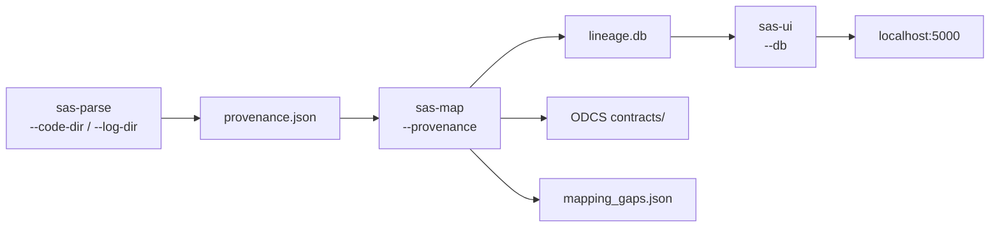

# 👻 Usage

## Lifecycle

Parse once. Map to contracts. Browse. Repeat when code changes.



---

## `sas-parse`

Ingests `.sas` source files and their verbose execution logs. Emits `provenance.json`.

```bash
sas-parse \
  --code-dir /path/to/sas/code \
  --log-dir  /path/to/verbose/logs \
  --estate   acme-risk \
  --output   provenance.json \
  --report   parse_report.json
```

| Option | Default | Description |
|---|---|---|
| `--code-dir` | required | Root directory of deployed `.sas` files |
| `--log-dir` | required | Root directory of verbose execution logs |
| `--estate` | `sas-estate` | Estate identifier embedded in `provenance.json` meta |
| `--output` | `provenance.json` | Output path for the provenance artefact |
| `--report` | `parse_report.json` | Summary: job/table/flag counts by reason |
| `--excel` | _(none)_ | Optional manual mapping `.xlsx` (source, target, job) to reconcile against parser output |

Logs must be verbose (`OPTIONS MLOGIC SYMBOLGEN;` at the top of each job or via scheduler job options). Without logs, macro variable references remain unresolved and surface as `macro_unresolved` flags.

### What gets parsed

| SAS construct | Extractor | Notes |
|---|---|---|
| `LIBNAME` statements | `LibnameExtractor` | Engine, path, layer, remote alias (SLIBREF); datasets inherit these by libref |
| `DATA` steps | `DataStepExtractor` | Target + SET/MERGE sources; assignment columns + lineage |
| `PROC SQL` | `ProcSqlExtractor` | CREATE TABLE; SELECT-list columns with column-level lineage chains carrying transformation expressions |
| Other `PROC` steps | `GenericProcExtractor` | SORT/FORMAT/etc: `data=`/`out=` tables; columns emit a flag for manual review |
| `RSUBMIT` blocks | `RsubmitExtractor` | Inner steps parsed and tagged remote; `remote_execution` flag raised |
| `%di_scd2*` macros | `Scd2Extractor` | In/out tables captured; columns flagged for review |

Column-level lineage is emitted as `LineageChain` objects with verbatim `transformation_logic` (the CASE expression, assignment, etc.). Each chain hop carries the step type and SQL/assignment text so the transformation is auditable at every layer. The builder stitches per-step edges into full source→MART chains, so the provenance of any MART column resolves in one flat query. When a DATA step merges >1 source, a `multi_source` flag is raised and the columns capture the transformation but upstream attribution remains unresolved.

### Flags

Anything unresolvable or ambiguous surfaces as a flag rather than being silently dropped:

| Reason | Trigger |
|---|---|
| `macro_unresolved` | `&macro_var` not resolved by log SYMBOLGEN/MLOGIC or code-level `%LET`/`%SYSLPUT` fallback |
| `dynamic_column_name` | `DATA` step output column is a macro reference (e.g. `&var`), name unknown |
| `hand_written_code` | `DATA` step with no `SET`/`MERGE`, implying bespoke logic with no clear upstream |
| `remote_execution` | `RSUBMIT` block executes on a remote server, so tracing is incomplete |
| `step_count_mismatch` | Log shows a different number of step completions than code contains blocks |
| `multi_source` | Unqualified column in multi-table join (source ambiguous), or `DATA` step MERGEs >1 source (per-column upstream unresolved), or PROC SQL with an unresolved macro source alongside real sources (attribution partial) |

---

## `sas-map`

Loads `provenance.json` into a SQLite/Turso database, generates ODCS contracts per table, and writes a gaps report.

```bash
sas-map \
  --provenance provenance.json \
  --db         lineage.db \
  --contracts-dir contracts/ \
  --gaps       mapping_gaps.json
```

| Option | Default | Description |
|---|---|---|
| `--provenance` | required | Path to `provenance.json` from `sas-parse` |
| `--db` | `lineage.db` | SQLite/Turso database output path |
| `--contracts-dir` | `contracts` | Directory for generated ODCS YAML contracts |
| `--gaps` | `mapping_gaps.json` | Gaps report: missing owners, domains, unmapped rules |
| `--owners` | _(none)_ | Optional CSV (`job,owner,domain`) merged into jobs/contracts |
| `--params` | _(none)_ | Optional quality-rule CSV (`job,rule_name,rule_definition,column_id`) |

Owner/domain and quality rules are the manual, human-supplied facts the parser
cannot know. They are keyed by job name and never overwrite parser output.

Runs are idempotent: `INSERT OR REPLACE` throughout. Re-running after a new parse pass updates the database in place.

### ODCS contracts

One YAML file per table, named `<LAYER>_<TABLE_NAME>.yml`. Format: [Open Data Contract Standard v2.3.0](https://github.com/bitol-io/open-data-contract-standard).

```yaml
apiVersion: v2.3.0
kind: DataContract
name: ALL_EMP
schema:
  layer: ODS
  columns: [...]
quality: [...]
freshness:
  frequency: daily
  evidence: [name_token:daily]
lineageFlags: [...]
```

Contracts consumed directly by [wraith-modelgen](https://git.thomaspeoples.com/thomaspeoples/wraith-modelgen).

### Gaps report

`mapping_gaps.json` surfaces four categories:

| Key | Meaning |
|---|---|
| `missing_owner` | Jobs with no `owner` field |
| `missing_domain` | Jobs with no `domain` field |
| `flagged_columns` | Lineage entries that carry extraction flags |
| `unmapped_quality_rules` | Quality rules not yet tied to a specific column |

---

## `sas-ui`

Read-only Flask app for browsing the lineage database.

```bash
sas-ui --db lineage.db
# → http://localhost:5000
```

| Route | Description |
|---|---|
| `/flags` | All extraction flags grouped by reason |
| `/provenance?col_id=<id>` | Full upstream lineage chain for a column |
| `/lineage?col_id=<id>` | Downstream: which MART columns does this feed? |

Column IDs are in the format `col_<12 hex chars>`. Find them in `provenance.json` or by querying `lineage.db` directly:

```sql
SELECT id, name, table_id FROM columns WHERE name = 'EXPOSURE_AMT';
```

---

## Freshness inference

`sas-map` infers SLA frequency without any external calendar:

1. **Job name tokens**: `DAILY`, `DLY`, `WEEKLY`, `WKLY`, `MONTHLY`, `MTHLY`, `QTR`, `YEARLY` → frequency label
2. **Log timestamps**: if ≥ 3 log execution timestamps exist, median gap → frequency label

Evidence is recorded in the contract under `freshness.evidence` so the inference is auditable.
